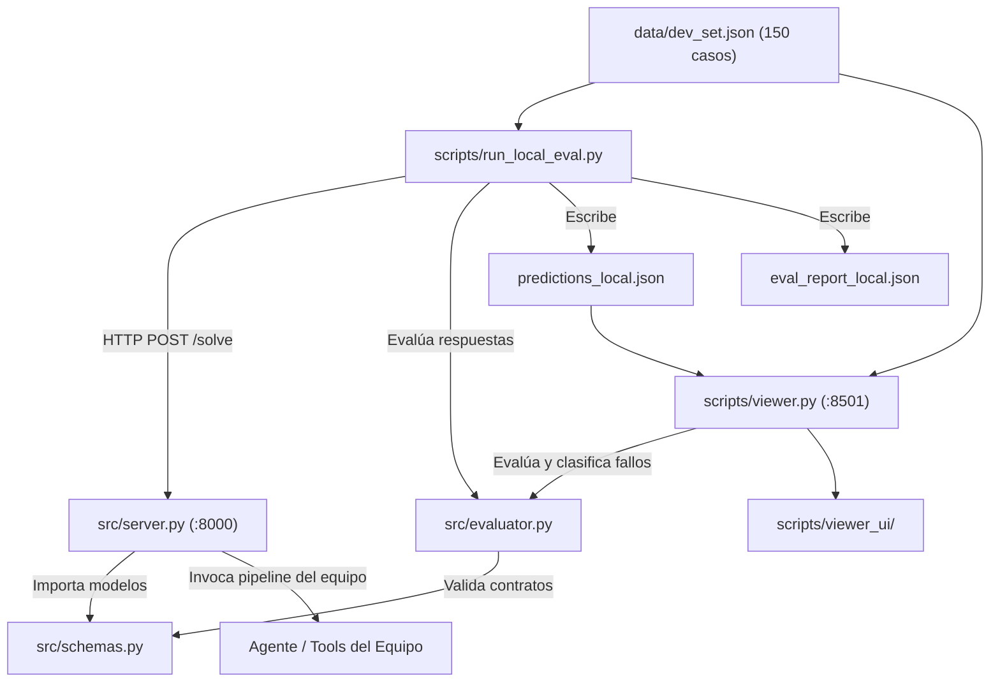
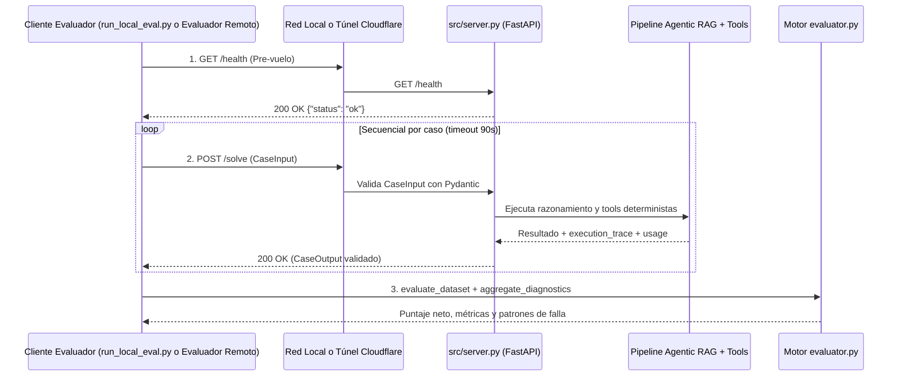
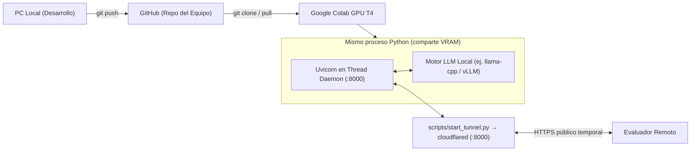
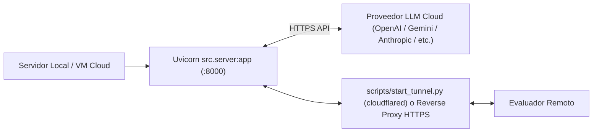

# ARCHITECTURE.md — Arquitectura del Starter Kit (`aieng-utn-rag-challenge`)

Este documento describe la arquitectura técnica del Starter Kit oficial del desafío **Agent-Based Financial QA Challenge (UTN FRSR)**, el contrato HTTP de caja negra, los flujos de evaluación offline y remota, y las topologías de despliegue soportadas.

---

## 1. Principio Arquitectónico: Evaluación Caja Negra

El sistema separa completamente la **infraestructura de contrato y evaluación** (provista por el Starter Kit y el Evaluador Remoto) de la **implementación agéntica de cada equipo**:

- La única frontera pública exigida es un servidor HTTP compatible con:
  - `GET /health`: verificación de disponibilidad previa a la evaluación.
  - `POST /solve`: recibe un `CaseInput` JSON y retorna un `CaseOutput` JSON validado con Pydantic v2.
- Internamente, cada equipo puede elegir libremente su modelo LLM (open-weight local o API cloud), su orquestación (pipeline secuencial, ReAct, grafo multi-agente, LangGraph, LlamaIndex, código puro, etc.) y sus herramientas deterministas.

---

## 2. Mapa de Componentes del Repositorio

```text
aieng-utn-rag-challenge/
├── data/
│   └── dev_set.json                   # 150 casos públicos (135 SOLVED + 15 ABSTAIN)
├── docs/
│   └── GUIA_DIDACTICA.md              # Guía de buenas prácticas, tools y resultados de referencia
├── notebooks/
│   └── Colab_Starter_Template.ipynb   # Entorno Colab GPU + servidor en hilo + cloudflared
├── scripts/
│   ├── run_local_eval.py              # Cliente HTTP de evaluación + reporte diagnóstico local
│   ├── start_tunnel.py                # Túnel Cloudflare hacia localhost (CLI y Colab)
│   ├── viewer.py                      # Backend FastAPI del visualizador web (:8501)
│   └── viewer_ui/                     # Interfaz estática (HTML/CSS/JS) del visualizador
├── src/
│   ├── __init__.py
│   ├── schemas.py                     # Contrato Pydantic v2 (CaseInput, CaseOutput, TokenUsage)
│   ├── evaluator.py                   # Motor de scoring, tolerancias, normalización y diagnóstico
│   └── server.py                      # Microservicio FastAPI (GET /health, POST /solve)
├── AGENTS.md                          # Reglas operativas para desarrolladores y agentes de código
├── ARCHITECTURE.md                    # Este documento
├── README.md                          # Resumen e inicio rápido
└── requirements.txt                   # Dependencias base del servicio HTTP y clientes
```

### Diagrama de dependencias entre módulos



### Responsabilidad de cada módulo clave

- **`src/schemas.py`**: define los modelos estrictos (`extra="forbid"`). Garantiza consistencia interna mediante validadores:
  - `TokenUsage.validate_token_sum`: `total_tokens == prompt_tokens + completion_tokens`.
  - `CaseOutput.validate_verdict_consistency`: si `verdict == "SOLVED"`, exige `primary_value` finito y `len(execution_trace) >= 1`; si `verdict == "ABSTAIN"`, normaliza `primary_value = None`.
- **`src/server.py`**: expone la aplicación FastAPI `app`. Su función `solve_endpoint(case_input: CaseInput) -> CaseOutput` viene inicialmente con un *stub* que responde `ABSTAIN` y debe conectarse al pipeline del equipo.
- **`src/evaluator.py`**: implementa la misma lógica de calificación usada por el Evaluador Remoto:
  - `compare_numeric_with_scale`: compatibilidad de `"percent"` y conversión de magnitudes (`None`, `"thousand"`, `"million"`, `"billion"`).
  - `evaluate_single_case` / `evaluate_dataset`: asignación de estados (`CORRECT`, `ABSTAIN_ON_UNSOLVABLE`, `ABSTAIN_CAUTIOUS`, `WRONG_VALUE`, `SCALE_MISMATCH`, `HALLUCINATION_ON_ABSTAIN`, `TIMEOUT`, `SCHEMA_ERROR`) y puntaje asimétrico (`+1.0`, `0.0`, `-1.0`, `-1.5`).
  - `aggregate_diagnostics` / `build_diagnostic_report`: cálculo de percentiles de latencia, desglose por `answer_from` (`table` vs `table-text`), clasificación de patrones de fallo (`classify_failure_hint`) y recomendaciones accionables.
- **`scripts/run_local_eval.py`**: cliente HTTP síncrono que valida `GET /health`, envía secuencialmente los casos de `data/dev_set.json` a `POST /solve` (timeout configurable, por defecto `90.0 s`), guarda `predictions_local.json` y `eval_report_local.json` e imprime el diagnóstico en consola.
- **`scripts/start_tunnel.py`**: utilidad de librería estándar con doble uso: CLI recomendado en local (Terminal 3: verifica `GET /health`, guía la instalación de `cloudflared` por sistema operativo si falta e imprime la URL `trycloudflare.com` hasta `Ctrl+C`) y módulo importable (`check_local_health()`, `start_tunnel()`, `stop_tunnel()`) reutilizado por la **Celda 5** de `notebooks/Colab_Starter_Template.ipynb`.
- **`scripts/viewer.py`**: servidor web ligero (`uvicorn` en `127.0.0.1:8501`) que carga `data/dev_set.json` y `predictions_local.json` (o cualquier archivo subido desde el navegador) para inspeccionar tablas, notas, *Ground Truth*, traza de herramientas y pista diagnóstica caso por caso.

---

## 3. Flujo de Datos: Evaluación Local vs. Evaluación Remota



### Diferencias operativas entre modos de ejecución

| Aspecto | Evaluación Local (`run_local_eval.py`) | Evaluación Remota (`<URL_EVALUADOR_REMOTO>`) |
| :--- | :--- | :--- |
| **Dataset** | `data/dev_set.json` (150 casos públicos) | Calibración (30 casos ciegos) / Final (100 casos ciegos) |
| **Acceso al *Ground Truth*** | Completo (en `eval_report_local.json` y `scripts/viewer.py`) | Opaco (Leaderboard público por mejor corrida; diagnóstico privado en `/api/runs/{run_id}/diagnostics`) |
| **Cuota y Cooldown** | Ilimitada (local) | Calibración: máx. `10` corridas/track, `600 s` cooldown desde el fin de cada corrida; Final: `1` intento/track habilitado por cátedra (`POST /api/runs/start`) |
| **Reintento transitorio** | No (reporta error HTTP directo) | 1 reintento automático (`3 s` backoff) ante `502`/`503`/`504` o error de red |
| **Concurrencia por equipo** | Secuencial (`1` caso por vez) | Secuencial (`1` caso por vez), `90 s` de timeout por caso |

---

## 4. Arquitectura de Evaluación, Escalas y Telemetría

El motor `src/evaluator.py` aplica un pipeline determinista sobre cada predicción:

1. **Validación estructural y timeout**: si la petición excede el timeout (`>90 s`), asigna `TIMEOUT` (`0.0` pts, aislado de errores de contrato); si falla por HTTP 5xx/conexión, no pasa `CaseOutput.model_validate(...)` o `pred.case_id != case.case_id`, asigna `SCHEMA_ERROR` (`-1.5` pts).
2. **Auditoría de telemetría**: marca `telemetry_anomaly = True` si `usage.total_tokens < 50` o `usage.llm_calls < 1`.
3. **Evaluación de veredicto**:
   - `ABSTAIN`: suma `0.0` pts (diferenciando `ABSTAIN_ON_UNSOLVABLE` vs `ABSTAIN_CAUTIOUS`).
   - `SOLVED` cuando *Ground Truth* es `ABSTAIN`: `HALLUCINATION_ON_ABSTAIN` (`-1.0` pt).
   - `SOLVED` cuando *Ground Truth* es `SOLVED`: ejecuta `compare_numeric_with_scale` y otorga `CORRECT` (`+1.0` pt), `SCALE_MISMATCH` (`-1.0` pt) o `WRONG_VALUE` (`-1.0` pt).

---

## 5. Topologías de Despliegue por Track

### 5.1 Track Open-Weight (Google Colab GPU T4)



- **Flujo de trabajo (en Colab no se desarrolla)**: cada equipo trabaja en su PC/host local sobre **su propio repositorio en GitHub** (fork/copia del Starter Kit, público/accesible por HTTPS para Colab) y hace `git push` a la rama principal (`main`). En Colab se ejecuta `notebooks/Colab_Starter_Template.ipynb` únicamente como runtime GPU: la **Celda 1** configura `REPO_URL` (`https://github.com/tu-usuario/el-repositorio.git`), clona o actualiza con `git pull` y define `sync_repo()`, la **Celda 2** prepara CUDA 12, y la **Celda 3** llama a `sync_repo()`, recarga los módulos `src/` y levanta (o reinicia) FastAPI automáticamente (solo reiniciá la sesión si aparece un error de VRAM/CUDA al recargar el GGUF).
- **Clave técnica**: levantar `uvicorn` dentro de un `threading.Thread(..., daemon=True)` en el mismo kernel que carga el modelo en GPU (tal como implementa la **Celda 3** de `notebooks/Colab_Starter_Template.ipynb`) evita duplicar la inicialización de CUDA o agotar la VRAM de la T4. A continuación, la **Celda 4** ejecuta la evaluación local independiente (`scripts/run_local_eval.py`) y la **Celda 5** abre o renueva el túnel con `start_tunnel()` de `scripts/start_tunnel.py`.

### 5.2 Track Cloud Propietario (APIs Gestionadas)



- **Exposición recomendada (Terminal 3)**: ejecutá `python scripts/start_tunnel.py` para verificar `GET /health`, abrir el túnel hacia `http://127.0.0.1:8000` e imprimir la URL pública; como alternativa podés invocar `cloudflared tunnel --url http://127.0.0.1:8000` manualmente o exponer un dominio HTTPS propio.
- **Clave técnica**: al delegar la inferencia a una API externa, no hay restricción de VRAM local, pero es crítico controlar latencia de red, *rate limits* del proveedor y consumo total de tokens (segundo criterio de desempate en el Leaderboard).
