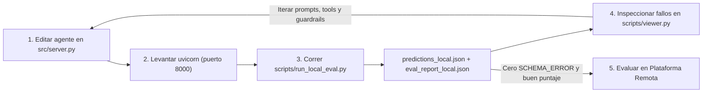
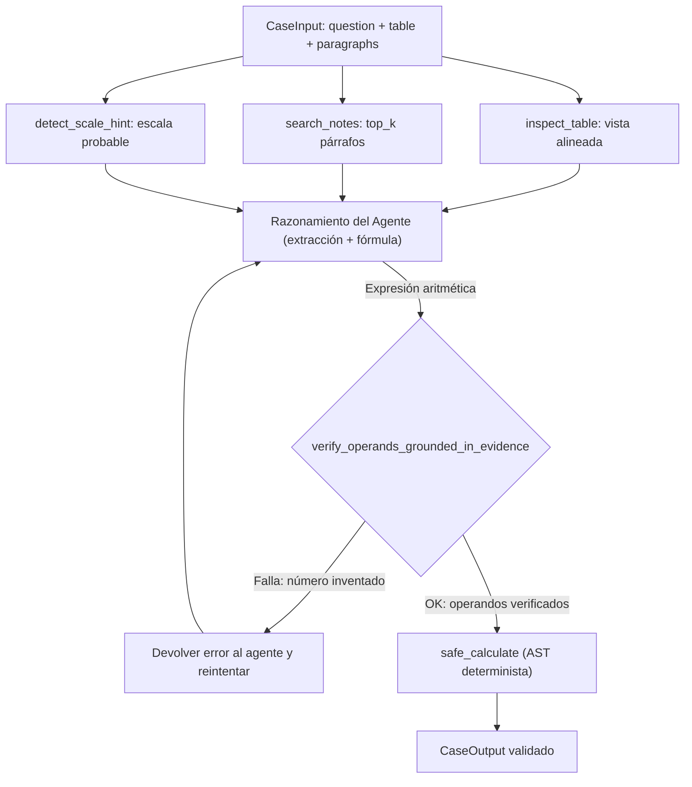
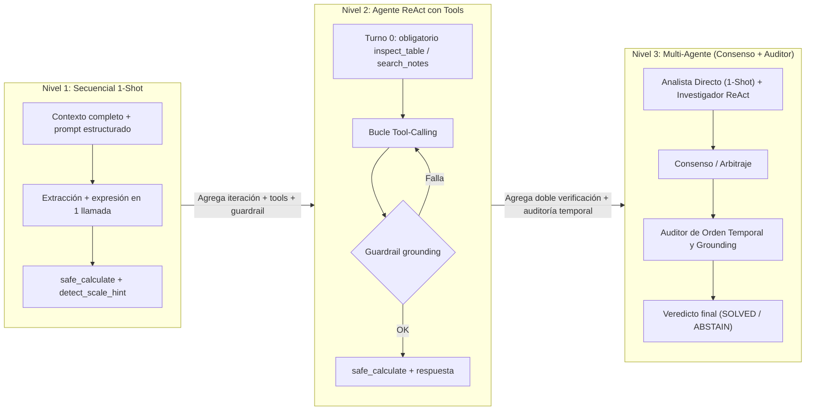
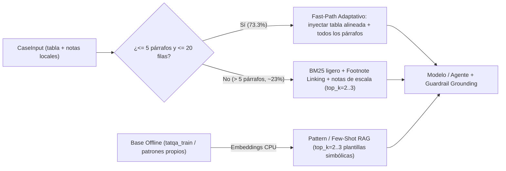
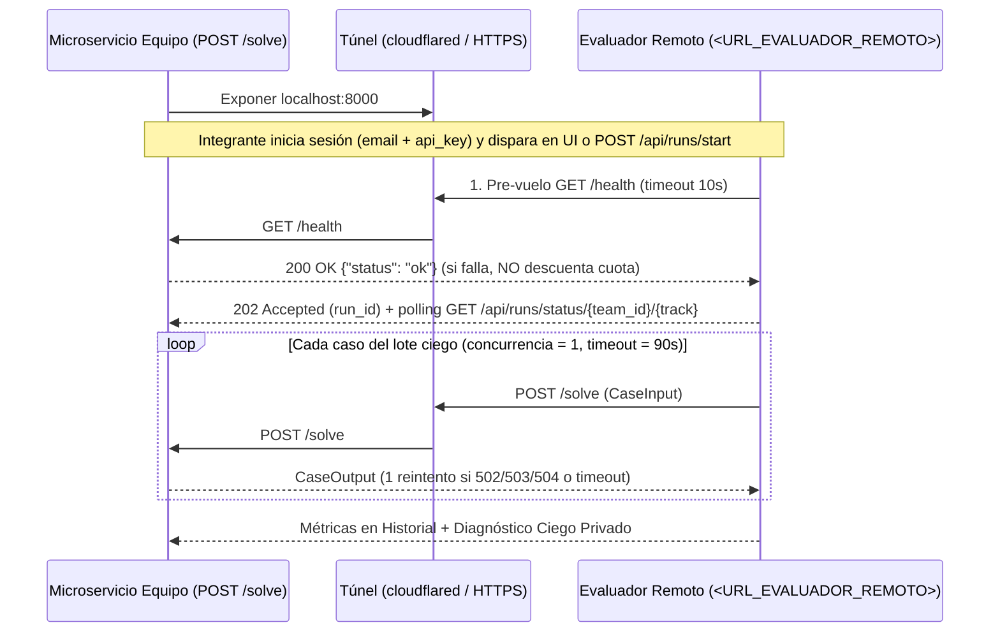

# Guía Didáctica y de Buenas Prácticas — Agent-Based Financial QA Challenge (UTN FRSR)

Esta guía acompaña al Starter Kit oficial (`aieng-utn-rag-challenge`) y reúne el mapa técnico del desafío, las primitivas deterministas recomendadas, un enfoque didáctico de referencia en 3 niveles con métricas reales de referencia, los patrones de falla más frecuentes y el procedimiento para utilizar la Plataforma de Evaluación Remota.

---

## 1. Introducción y Misión del Desafío

El objetivo del desafío es construir un sistema de **Agent-Based Financial QA** expuesto como un microservicio HTTP de **caja negra** (`GET /health` y `POST /solve`), capaz de responder consultas cuantitativas sobre reportes financieros híbridos (**Formularios 10-K / TAT-QA**) combinando:

- **Lectura tabular estructurada** (matrices 2D con encabezados simples o jerárquicos, años ordenados en cualquier dirección y múltiples unidades).
- **Comprensión de notas aclaratorias** (párrafos narrativos donde suelen aclararse unidades, excepciones, ajustes o cifras complementarias).
- **Cómputo aritmético determinista** (delegando toda operación matemática fuera del LLM).
- **Abstención responsable (`ABSTAIN`)** cuando la evidencia indispensable fue amputada o es insuficiente para responder sin inventar datos.

### 1.1 Mapa de archivos del Starter Kit

| Ruta | Rol en el Starter Kit |
| :--- | :--- |
| `src/schemas.py` | Contrato formal Pydantic v2 (`CaseInput`, `CaseOutput`, `ExecutionStep`, `TokenUsage`, `GroundTruth`, `DatasetCase`). **No modificar.** |
| `src/evaluator.py` | Motor oficial de calificación y diagnóstico offline (`evaluate_dataset`, `compare_numeric_with_scale`, `build_diagnostic_report`). **No modificar.** |
| `src/server.py` | Plantilla FastAPI con `GET /health` y `POST /solve`. Punto de integración de tu sistema. |
| `data/dev_set.json` | Dataset público de desarrollo con **150 casos** (`135 SOLVED` + `15 ABSTAIN`; `61 table` + `89 table-text`; escalas: `56 percent`, `42 thousand`, `33 null`, `19 million`). |
| `scripts/run_local_eval.py` | Cliente HTTP secuencial contra tu `POST /solve` local; genera `predictions_local.json` y `eval_report_local.json`. |
| `scripts/viewer.py` | Visualizador web (`http://127.0.0.1:8501`) para inspeccionar casos, tablas, párrafos, *Ground Truth* y predicciones en `scripts/viewer_ui/`. |
| `notebooks/Colab_Starter_Template.ipynb` | Plantilla para el **Track Open-Weight** en Google Colab GPU T4 (CUDA 12, `llama-cpp-python`, `uvicorn` compartiendo VRAM y túnel `cloudflared`). |
| `requirements.txt` | Dependencias base (`fastapi`, `uvicorn`, `pydantic`, `httpx`, `python-dotenv`). |

### 1.2 Flujo de desarrollo iterativo local



Comandos base del ciclo local:

```bash
# Terminal 1: levantar el microservicio
uvicorn src.server:app --host 0.0.0.0 --port 8000

# Terminal 2: prueba rápida (20 casos) y luego corrida completa (150 casos)
python scripts/run_local_eval.py --limit 20 --verbose
python scripts/run_local_eval.py

# Terminal 3 (opcional): explorar casos y fallos en el navegador
python scripts/viewer.py --open
```

---

## 2. Contrato Estricto de Entrada/Salida y Reglas de Puntuación

Tu microservicio debe respetar al 100% el contrato definido en `src/schemas.py`. Cualquier desviación produce un `SCHEMA_ERROR` penalizado con **`-1.5` puntos**.

### 2.1 Entrada (`CaseInput`) y Salida (`CaseOutput`)

* **`CaseInput`** contiene:
  * `case_id` (`str`): identificador único que debe devolverse idéntico en `CaseOutput.case_id`.
  * `question` (`str`): pregunta financiera o contable.
  * `table` (`list[list[str]]`): matriz 2D de celdas de la tabla del 10-K.
  * `paragraphs` (`list[Paragraph]`): lista ordenada de notas aclaratorias (`index` 1-based y `text`).
* **`CaseOutput`** exige:
  * `case_id` (`str`): debe coincidir exactamente con el `case_id` recibido.
  * `verdict` (`"SOLVED" | "ABSTAIN"`).
  * `primary_value` (`float | None`): obligatorio y finito si `verdict == "SOLVED"`; normalizado a `None` si `verdict == "ABSTAIN"`.
  * `scale` (`None | "thousand" | "million" | "billion" | "percent"`): cuando `scale == "percent"`, el número debe estar expresado en **puntos porcentuales `0–100`** (ejemplo: `15.4` para `15.4%`, nunca `0.154`).
  * `derivation` (`str` no vacío): expresión aritmética ejecutada (si `SOLVED`) o justificación de la falta de evidencia (si `ABSTAIN`).
  * `execution_trace` (`list[ExecutionStep]`): secuencia 1-based (`step_index`, `tool_name`, `tool_input`, `tool_output`). **Debe contener al menos 1 paso cuando `verdict == "SOLVED"`.**
  * `usage` (`TokenUsage`): `prompt_tokens`, `completion_tokens`, `total_tokens` y `llm_calls`. Debe cumplirse exactamente `total_tokens == prompt_tokens + completion_tokens`. Además, `src/evaluator.py` marca `telemetry_anomaly = True` si `total_tokens < 50` o `llm_calls < 1`.

### 2.2 Normalización dimensional y tolerancias (`src/evaluator.py`)

* **`percent`** solo es compatible con **`percent`**. Devolver `scale=None` o `"million"` cuando el *Ground Truth* es `"percent"` (o viceversa) produce `SCALE_MISMATCH` (`-1.0` punto).
* Las magnitudes monetarias/numéricas (`None` -> `1`, `"thousand"` -> `1,000`, `"million"` -> `1,000,000`, `"billion"` -> `1,000,000,000`) se convierten automáticamente al marco de referencia del *Ground Truth* antes de comparar:

$$\text{pred\_norm} = \text{primary\_value} \times \frac{\text{factor}(\text{pred\_scale})}{\text{factor}(\text{gt\_scale})}$$

* Una respuesta `SOLVED` se considera correcta (`CORRECT`) si cumple al menos una de las dos tolerancias:
  * Error absoluto: $|\text{pred\_norm} - \text{gt}| \le 0.01$
  * Error relativo: $\frac{|\text{pred\_norm} - \text{gt}|}{|\text{gt}|} \le 0.001$

### 2.3 Función de puntuación asimétrica y desempate

| Estado de Evaluación | Condición | Puntaje |
| :--- | :--- | :---: |
| `CORRECT` | `SOLVED` correcto dentro de tolerancia y escala compatible | **`+1.0`** |
| `ABSTAIN_ON_UNSOLVABLE` | `ABSTAIN` declarado en caso donde el *Ground Truth* es `ABSTAIN` | **`0.0`** |
| `ABSTAIN_CAUTIOUS` | `ABSTAIN` declarado en caso resoluble (evita arriesgar `-1.0`, pero resigna `+1.0`) | **`0.0`** |
| `WRONG_VALUE` | `SOLVED` con valor numérico fuera de tolerancia | **`-1.0`** |
| `SCALE_MISMATCH` | `SOLVED` con escala incompatible (`percent` vs no-`percent`) | **`-1.0`** |
| `HALLUCINATION_ON_ABSTAIN` | `SOLVED` emitido sobre un caso cuyo *Ground Truth* es `ABSTAIN` | **`-1.0`** |
| `TIMEOUT` | Tiempo de espera agotado (`>90s`) sin respuesta del endpoint (aislado de `SCHEMA_ERROR`) | **`0.0`** |
| `SCHEMA_ERROR` | Violación de `CaseOutput`, desalineación de `case_id` o error HTTP 5xx/conexión | **`-1.5`** |

La asimetría es intencional: **adivinar sin evidencia cuesta el doble de diferencia que abstenerse (`-1.0` vs `0.0`)**, y romper el contrato o caerse cuesta aún más (`-1.5`).

**Orden de desempate en el Leaderboard:**
1. Mayor **Puntaje Neto** acumulado (`net_score`).
2. Menor consumo total de **tokens** (`total_tokens`).
3. Menor **latencia promedio** por caso (`avg_latency_ms`).

---

## 3. Catálogo de Tools Recomendadas y Guardrails Deterministas

Entregar una matriz `list[list[str]]` cruda al prompt del LLM y pedirle que "haga la cuenta mentalmente" provoca errores sistemáticos de alineación de columnas, redondeos incorrectos y alucinaciones numéricas. A continuación se describen **5 primitivas deterministas** recomendadas (especificación conceptual y pseudocódigo) para que cada equipo las implemente en su propia arquitectura.



### 3.1 `inspect_table` — Inspección y alineación tabular

* **Propósito:** Formatear la matriz 2D en una representación legible sin pérdida de encabezados ni desplazamientos horizontales de columnas.
* **Contrato:**
  * **Entrada:** `table: list[list[str]]`, `row_query: str | None = None`, `max_rows: int = 45`.
  * **Salida:** `str` con la tabla en Markdown + bloque adicional `[Alineación columna=valor por fila]`.
* **Invariantes clave:**
  * Detectar dinámicamente si la tabla tiene **1 o 2 filas de encabezado** (contando cuántas celdas de `table[1]` contienen montos numéricos; importante: **los años como `2019` o `2018` son encabezados, no datos numéricos**).
  * Si `row_query` tiene palabras clave útiles (quitando *stopwords*), filtrar filas que coincidan, preservando siempre todas las filas de encabezado; si el filtro queda vacío, hacer fallback a la tabla completa para no ocultar evidencia.
  * Generar la vista explícita `Fila -> Columna_1: Valor_1 | Columna_2: Valor_2` para que el LLM nunca confunda columnas adyacentes.
* **Pseudocódigo de alto nivel:**
  ```text
  FUNCION inspect_table(table, row_query=None, max_rows=45):
      SI table está vacía: RETORNAR "EMPTY_TABLE"
      header_count = 1 si fila[1] tiene >= 2 valores monetarios/porcentuales (excluyendo años 19xx/20xx), si no 2
      header_rows = table[:header_count]
      body_rows = table[header_count:]
      SI row_query tiene tokens relevantes:
          filtrar body_rows que contengan alguno de los tokens; si hay coincidencias, usarlas
      renderizar header_rows + body_rows[:max_rows] como tabla Markdown
      construir nombres completos de columna combinando header_rows por índice de columna
      PARA cada fila mostrada (hasta un umbral compacto, ej. 25 filas):
          emitir "- <etiqueta_fila> -> <col_1>: <val_1> | <col_2>: <val_2> ..."
      RETORNAR texto combinado
  ```

### 3.2 `search_notes` — Búsqueda léxica en notas aclaratorias

* **Propósito:** Recuperar los párrafos más relevantes para la consulta sin saturar la ventana de contexto cuando un documento tiene muchos párrafos, preservando el orden narrativo original.
* **Contrato:**
  * **Entrada:** `paragraphs: list[Paragraph]`, `query: str`, `top_k: int = 5`.
  * **Salida:** `str` con los `top_k` párrafos formateados como `[Paragraph {index}] {text}`.
* **Invariantes clave:**
  * Ponderar más alto las coincidencias exactas de **años de 4 dígitos** (ej. `2019`, `2018`) y términos técnicos/contables largos (`>= 6` caracteres) frente a palabras cortas o coincidencias parciales.
  * Ordenar por puntaje descendente para elegir los `top_k`, pero **reordenar el subconjunto elegido por `p.index` ascendente** antes de devolverlo, manteniendo la coherencia temporal del texto.
* **Pseudocódigo de alto nivel:**
  ```text
  FUNCION search_notes(paragraphs, query, top_k=5):
      SI paragraphs está vacío: RETORNAR "NO_PARAGRAPHS_AVAILABLE"
      tokens = extraer palabras alfanuméricas de query excluyendo stopwords y longitud <= 1
      PARA cada párrafo p en paragraphs:
          score = 0
          PARA cada token qt en tokens:
              SI qt aparece como token exacto en p.text:
                  score += 2.5 si qt es año de 4 dígitos, 1.5 si len(qt) >= 6, si no 1.0
              SINO SI qt aparece como subcadena:
                  score += 0.5
      seleccionar los top_k párrafos con mayor score
      reordenar los seleccionados por p.index ascendente
      RETORNAR lista formateada "[Paragraph i] texto"
  ```

### 3.3 `safe_calculate` — Calculadora aritmética determinista vía AST

* **Propósito:** Garantizar exactitud numérica absoluta y seguridad de ejecución (sin `eval()` arbitrario).
* **Contrato:**
  * **Entrada:** `expression: str` (ej. `"(4785.7 - 5087.6) / 5087.6 * 100"`).
  * **Salida:** `float` finito redondeado (ej. a 6 decimales) o excepción controlada ante sintaxis inválida / división por cero.
* **Invariantes clave:**
  * Normalizar corchetes `[ ]` a `( )`, remover símbolos monetarios (`$`, `€`, `£`, `%`) y eliminar comas separadoras de miles (`1,452.4` -> `1452.4`) sin romper comas de funciones como `min(a, b)` o `max(a, b)`.
  * Parsear la expresión con un **árbol de sintaxis abstracta (AST)** y recorrer recursivamente únicamente nodos permitidos: constantes numéricas, operadores unarios (`+`, `-`), operadores binarios (`+`, `-`, `*`, `/`, `**`) y funciones seguras acotadas (`abs`, `round`, `min`, `max`).
  * Rechazar división por cero (`abs(divisor) < 1e-12`) y validar que el resultado no sea `NaN` ni `Inf`.
* **Pseudocódigo de alto nivel:**
  ```text
  FUNCION safe_calculate(expression):
      limpiar espacios, reemplazar [] por (), quitar $, €, £, %
      remover comas únicamente entre dígitos de miles (ej. 1,234 -> 1234)
      parsear expresión en árbol AST en modo "eval"
      FUNCION eval_nodo(nodo):
          SI constante numérica: RETORNAR float(valor)
          SI operación unaria permitida (+, -): aplicar sobre eval_nodo(operando)
          SI operación binaria permitida (+, -, *, /, **):
              evaluar izquierda y derecha; si es división y |derecha| < 1e-12 lanzar error
              aplicar operador
          SI llamada a función en {abs, round, min, max}: evaluar argumentos y ejecutar
          EN OTRO CASO: lanzar error de operación no permitida
      resultado = eval_nodo(raíz)
      verificar resultado finito (no NaN, no Inf) y retornar redondeado a 6 decimales
  ```

### 3.4 `detect_scale_hint` — Inferencia de escala dimensional

* **Propósito:** Reducir errores `SCALE_MISMATCH` y `magnitude_10x` sugiriendo la unidad esperada (`"percent"`, `"thousand"`, `"million"`, `"billion"` o `None`).
* **Contrato:**
  * **Entrada:** `table: list[list[str]]`, `paragraphs: list[Paragraph]`, `question: str`.
  * **Salida:** `ScaleType | None`.
* **Invariantes clave (orden estricto de prioridad):**
  1. **Porcentajes:** si la pregunta pide `percentage`, `percent`, `%`, `margin` o `rate` (y **no** `percentage point` / `basis point`), la escala es `"percent"`.
  2. **Preguntas adimensionales o unitarias:** si pide `per share`, `share price`, `exercise price`, `proportion of` o `ratio of`, la escala esperada es `None` (aun si la tabla dice `(in millions)` en el encabezado).
  3. **Encabezados de tabla (`table[:3]`):** buscar declaraciones explícitas (`in billions`, `in millions`, `in thousands`, `$'000`, `(000s)`, `$M`, `$B`).
  4. **Párrafos narrativos:** buscar aclaraciones entre paréntesis (`(in millions)`) o intros de tabla (`following table ... in thousands`).
  5. **Fallback:** menciones generales de escala en pregunta/encabezados primero, y luego en párrafos.
* **Pseudocódigo de alto nivel:**
  ```text
  FUNCION detect_scale_hint(table, paragraphs, question):
      SI question pide porcentaje/margen/tasa (sin "percentage point" ni "basis point"):
          RETORNAR "percent"
      SI question pide valor "per share", precio de acción, "proportion of" o "ratio of":
          RETORNAR None
      header_text = concatenar primeras 3 filas de table
      notes_text = concatenar todos los paragraphs
      buscar patrones explícitos de billion/million/thousand en header_text -> retornar si hay match
      buscar declaraciones entre paréntesis "(... in billions/millions/thousands ...)" o intros en notes_text -> retornar si hay match
      fallback: buscar palabras "billion"/"million"/"thousand" en (question + header_text), luego en notes_text
      RETORNAR None si no hay coincidencias
  ```

### 3.5 `verify_operands_grounded_in_evidence` — Guardrail de respaldo de operandos

* **Propósito:** Detectar antes de responder si el LLM alucinó un número que no existe en el documento (muy frecuente en casos `ABSTAIN` amputados o por error de lectura OCR/tabular).
* **Contrato:**
  * **Entrada:** `expression: str`, `case_input: CaseInput`.
  * **Salida:** `(is_grounded: bool, ungrounded_operands: list[str])`.
* **Invariantes clave:**
  * Extraer todos los literales numéricos de `expression`, ignorando constantes estructurales de fórmulas (`0`, `1`, `2`, `3`, `4`, `5`, `10`, `12`, `100`, `360`, `365`, `1000`).
  * Recolectar el conjunto de valores numéricos presentes en todas las celdas de `case_input.table` y todos los `case_input.paragraphs` (en valor absoluto, normalizando comas de miles).
  * Verificar que cada operando de la expresión tenga una coincidencia dentro de una tolerancia mínima (`1e-4`). Si falta alguno, rechazar la expresión o devolver el feedback exacto al agente para que corrija o emita `ABSTAIN`.
* **Pseudocódigo de alto nivel:**
  ```text
  FUNCION verify_operands_grounded_in_evidence(expression, case_input):
      constantes_formula = {0, 1, 2, 3, 4, 5, 10, 12, 100, 360, 365, 1000}
      operandos = extraer todos los números de expression (quitando comas de miles)
      evidencia = conjunto de |float(n)| para todo número encontrado en table y paragraphs
      no_respaldados = []
      PARA cada op en operandos:
          SI op está en constantes_formula: continuar
          SI ningún valor en evidencia difiere en <= 1e-4 de |float(op)|:
              agregar op a no_respaldados
      RETORNAR (len(no_respaldados) == 0, no_respaldados)
  ```

---

## 4. Enfoque Recomendado como Referencia Didáctica (Progresión en 3 Niveles)

> [!IMPORTANT]
> **Aclaración fundamental sobre la evaluación:**
> La progresión en 3 niveles detallada a continuación se presenta **únicamente como una recomendación de enfoque y con propósito didáctico**: refleja el diseño incremental usado por la cátedra para poner de manifiesto distintos modos de falla y cómo cada capa arquitectónica los mitiga.
> **No es una estructura obligatoria ni será evaluada.** La evaluación oficial es 100% **caja negra sobre `POST /solve`**: cada equipo tiene libertad total para elegir el patrón, framework o arquitectura que mejor se adapte a su estrategia.

### 4.1 Qué resuelve cada nivel de la referencia didáctica



1. **Nivel 1 — Pipeline Secuencial 1-shot:**
   - Una sola llamada al LLM recibiendo la tabla alineada, las notas y el *hint* de escala, devolviendo un JSON con veredicto y expresión para ejecutar con `safe_calculate`.
   - **Ventaja:** mínima latencia y mínimo consumo de tokens.
   - **Limitación:** en modelos chicos (`7B`), tiende a confundir columnas en tablas densas, invertir el orden de las restas temporales y alucinar sobre casos `ABSTAIN`.
2. **Nivel 2 — Agente ReAct con Tools y Feedback de Grounding:**
   - Bucle de *Tool-Calling* donde el agente decide qué filas inspeccionar (`inspect_table`), qué párrafos recuperar (`search_notes`) y qué calcular (`safe_calculate`).
   - Incorpora feedback automático del guardrail (`verify_operands_grounded_in_evidence`): si intenta calcular con un número inexistente, recibe el error en el historial para autocorregirse o abstenerse.
   - **Ventaja:** reduce drásticamente errores de escala (`SCALE_MISMATCH`) y mejora la detección de `ABSTAIN`.
3. **Nivel 3 — Sistema Multi-Agente (Analista + ReAct + Auditor de Orden Temporal/Grounding):**
   - Combina una extracción directa (Analista 1-Shot) y una exploración autónoma (Investigador ReAct) con un **Auditor** final encargado exclusivamente de arbitrar y validar tres puntos críticos antes de emitir `SOLVED`:
     1. Que los operandos estén respaldados en evidencia real.
     2. Que el orden de resta corresponda a `Valor_Reciente - Valor_Base` (evitando errores de signo).
     3. Que exista coherencia entre la pregunta (`change` vs `percentage change`), la derivación y la escala.

### 4.2 Resultados de referencia obtenidos por la cátedra

Los siguientes resultados fueron medidos sobre el mismo código base de referencia en dos tracks:
- **`dev_set.json`**: 150 casos (`135 SOLVED` + `15 ABSTAIN`; `61 table` + `89 table-text`). Puntaje máximo teórico: `+135.00`.
- **Conjunto de Calibración (ciego)**: 30 casos perturbados (`27 SOLVED` + `3 ABSTAIN`; `9 table` + `21 table-text`). Puntaje máximo teórico: `+27.00`.

#### Track Open-Weight (`Qwen2.5-7B-Instruct-Q4_K_M.gguf` · Google Colab GPU T4 · `n_ctx = 16384` · `temperature = 0.0`)

**En `dev_set.json` (150 casos):**

| Métrica | Nivel 1 (Secuencial) | Nivel 2 (ReAct) | Nivel 3 (Consenso + Auditor) |
| :--- | :---: | :---: | :---: |
| **Puntaje Neto** | **+22.00 / +135.00** | **+32.00 / +135.00** | **+68.00 / +135.00** |
| **Exactitud Global (`accuracy_rate`)** | 57.33% | 61.33% | **74.00%** |
| `CORRECT` (sobre 135 `SOLVED`) | 80 (59.3%) | 84 (62.2%) | **101 (74.8%)** |
| `ABSTAIN_ON_UNSOLVABLE` (sobre 15) | 6 (40.0%) | 8 (53.3%) | **10 (66.7%)** |
| `ABSTAIN_CAUTIOUS` | 6 | 6 | 6 |
| `WRONG_VALUE` | 43 | 43 | **26** |
| `SCALE_MISMATCH` | 6 | **2** | **2** |
| `HALLUCINATION_ON_ABSTAIN` | 9 | 7 | **5** |
| Rendimiento `table` (61 casos) | 35/61 (57.4%) | 39/61 (63.9%) | **48/61 (78.7%)** |
| Rendimiento `table-text` (89 casos) | 51/89 (57.3%) | 53/89 (59.6%) | **63/89 (70.8%)** |
| Latencia avg / p95 / max | **7.45 s** / 10.48 s / 14.63 s | 17.15 s / 24.49 s / 38.88 s | 28.05 s / 37.97 s / 55.24 s |
| Tokens / Llamadas LLM | 184,034 / 150 | 613,858 / 325 | 794,538 / 474 |

**En Conjunto de Calibración (30 casos ciegos, evaluación E2E HTTP vía `cloudflared`):**

| Métrica | Nivel 1 | Nivel 2 | Nivel 3 |
| :--- | :---: | :---: | :---: |
| **Puntaje Neto** | **+13.00 / +27.00** | **+16.00 / +27.00** | **+21.00 / +27.00** |
| `CORRECT` (sobre 27 `SOLVED`) | 20 (74.1%) | 22 (81.5%) | **24 (88.9%)** |
| `ABSTAIN_ON_UNSOLVABLE` (sobre 3) | 1 (33.3%) | **2 (66.7%)** | **2 (66.7%)** |
| `ABSTAIN_CAUTIOUS` | 2 | **0** | 1 |
| `WRONG_VALUE` | 5 | 5 | **2** |
| `SCALE_MISMATCH` | **0** | **0** | **0** |
| `HALLUCINATION_ON_ABSTAIN` | 2 | **1** | **1** |
| Rendimiento `table` (9 casos) | 8/9 (88.9%) | 8/9 (88.9%) | **8/9 (88.9%)** |
| Rendimiento `table-text` (21 casos) | 13/21 (61.9%) | 16/21 (76.2%) | **18/21 (85.7%)** |
| Latencia avg / p95 / max | **7.94 s** / 11.24 s / 12.80 s | 18.35 s / 27.22 s / 37.26 s | 27.50 s / 36.70 s / 37.99 s |
| Casos `>45s` / Errores HTTP-Esquema | 0 / 0 | 0 / 0 | 0 / 0 |
| Tokens totales | 34,553 | 122,931 | 151,573 |

#### Track Cloud Propietario (`openai/gpt-4.1-mini` · `temperature = 0.0`)

**En `dev_set.json` (150 casos):**

| Métrica | Nivel 1 (Secuencial) | Nivel 2 (ReAct) | Nivel 3 (Consenso + Auditor) |
| :--- | :---: | :---: | :---: |
| **Puntaje Neto** | **+88.00 / +135.00** | **+97.00 / +135.00** | **+97.00 / +135.00** |
| **Exactitud Global (`accuracy_rate`)** | 81.33% | 84.00% | **84.67%** |
| `CORRECT` (sobre 135 `SOLVED`) | 108 (80.0%) | **113 (83.7%)** | **113 (83.7%)** |
| `ABSTAIN_ON_UNSOLVABLE` (sobre 15) | **14 (93.3%)** | 13 (86.7%) | **14 (93.3%)** |
| `ABSTAIN_CAUTIOUS` | 8 | 8 | **7** |
| `WRONG_VALUE` | 18 | **12** | 13 |
| `SCALE_MISMATCH` | **1** | 2 | 2 |
| `HALLUCINATION_ON_ABSTAIN` | **1** | 2 | **1** |
| Rendimiento `table` (61 casos) | 49/61 (80.3%) | 54/61 (88.5%) | **55/61 (90.2%)** |
| Rendimiento `table-text` (89 casos) | **73/89 (82.0%)** | 72/89 (80.9%) | 72/89 (80.9%) |
| Latencia promedio | **1.55 s** | 3.84 s | 5.52 s |
| Tokens (in / out) | 148,011 / 12,974 | 486,911 / 39,606 | 634,349 / 52,335 |
| **Costo real (USD)** | **USD 0.0800** | **USD 0.2581** | **USD 0.3375** |

**En Conjunto de Calibración (30 casos ciegos):**

| Métrica | Nivel 1 | Nivel 2 | Nivel 3 |
| :--- | :---: | :---: | :---: |
| **Puntaje Neto** | **+24.00 / +27.00** | **+21.00 / +27.00** | **+24.00 / +27.00** |
| **Exactitud Global (`accuracy_rate`)** | **93.33%** | 83.33% | **93.33%** |
| `CORRECT` (sobre 27 `SOLVED`) | **25 (92.6%)** | 24 (88.9%) | **25 (92.6%)** |
| `ABSTAIN_ON_UNSOLVABLE` (sobre 3) | **3 (100.0%)** | 1 (33.3%) | **3 (100.0%)** |
| `ABSTAIN_CAUTIOUS` | **1** | 2 | **1** |
| `WRONG_VALUE` | **1** | **1** | **1** |
| `SCALE_MISMATCH` / `HALLUCINATION` | **0 / 0** | 0 / 2 | **0 / 0** |
| Rendimiento `table` (9 casos) | **9/9 (100.0%)** | 7/9 (77.8%) | **9/9 (100.0%)** |
| Rendimiento `table-text` (21 casos) | **19/21 (90.5%)** | 18/21 (85.7%) | **19/21 (90.5%)** |
| Latencia promedio | **2.05 s** | 3.51 s | 5.15 s |
| Tokens (in / out) | 27,758 / 2,595 | 92,532 / 7,576 | 119,676 / 10,146 |
| **Costo real (USD)** | **USD 0.0153** | **USD 0.0491** | **USD 0.0641** |

**Lectura comparativa clave:**
- En **modelos Open-Weight locales (`Qwen 2.5 7B`)**, la arquitectura marca una diferencia masiva: pasar de un enfoque 1-shot a un agente con tools y luego a un flujo con consenso y auditoría triplicó el puntaje neto en `dev_set` (`+22.00` -> `+32.00` -> `+68.00`) y llevó la calibración ciega a `+21.00 / +27.00`.
- En **modelos Cloud propietarios (`gpt-4.1-mini`)**, el costo de ejecutar todo el experimento (las 6 corridas completas, 540 evaluaciones) fue de apenas **USD 0.8041 totales**, y el Nivel 3 permitió consolidar el techo máximo en ambos datasets sin las alucinaciones que sufrió ReAct en calibración (`+21.00` -> `+24.00`).

---

## 5. Buenas Prácticas, Patrones de Falla Reales y Tips de Ingeniería

El evaluador (`src/evaluator.py`) clasifica automáticamente los errores en categorías accionables. Estos son los aprendizajes de ingeniería que mayor impacto tuvieron sobre el puntaje neto:

1. **Variación absoluta vs. variación porcentual (`change` vs. `percentage change`):**
   - Si la pregunta dice `"What was the change in..."` o `"difference between..."`, la respuesta es una **resta simple** (`Valor_Reciente - Valor_Base`) con la escala monetaria de la tabla (ej. `"million"`), **no** un porcentaje.
   - Sólo usar `(Valor_Reciente - Valor_Base) / Valor_Base * 100` con `scale = "percent"` cuando la pregunta solicite explícitamente porcentaje, tasa o margen.
   - Si `scale == "percent"`, asegurarse de multiplicar por `100` (`percent_decimal` es uno de los errores más fáciles de eliminar).
2. **No re-escalar valores ya expresados en la unidad de la tabla (`magnitude_10x`):**
   - Si una tabla declara `(in thousands)` y una celda dice `4,500`, el valor reportado es `4500.0` con `scale="thousand"`, **no** `4500000.0` con `scale="thousand"` ni `4.5` con `scale="thousand"`.
   - Recordá que `evaluator.py` normaliza automáticamente `primary_value` junto con `scale`: mantené siempre coherencia 1-a-1 entre el número devuelto y la etiqueta `scale`.
3. **Inversión de signo temporal (`sign_error`):**
   - Muchos formularios 10-K ordenan las columnas de **más reciente a más antiguo** de izquierda a derecha (`| Concepto | 2019 | 2018 |`).
   - Un LLM que lee mecánicamente de izquierda a derecha o al revés suele invertir la resta (`2018 - 2019` en lugar de `2019 - 2018`), perdiendo 2 puntos de diferencia (`+1.0` vs `-1.0`).
   - Explicitar en el prompt (o en un nodo Auditor) la regla invariante: **`Valor_Año_Más_Reciente - Valor_Año_Más_Antiguo`**, verificando siempre los encabezados de columna.
4. **Bloqueo de cálculo o abstención en el Turno 0 (en agentes iterativos / ReAct):**
   - Si permitís que el agente llame a `safe_calculate` o emita `ABSTAIN` en su primer paso sin haber inspeccionado antes la tabla y las notas (`inspect_table` / `search_notes`), suele saltar a conclusiones con información incompleta.
   - En la primera iteración, restringí las herramientas habilitadas solo a inspección/recuperación (`inspect_table`, `search_notes`), o pre-inyectá la tabla alineada y los párrafos recuperados antes del turno de decisión.
5. **Evitar contaminación y ceguera contextual en Multi-Agente:**
   - **Ceguera a notas aclaratorias:** más de la mitad del dataset (`89/150` en `dev_set.json`) es `table-text`. Un nodo planificador o extractor que mire solo la tabla fallará sistemáticamente cuando la definición de un concepto o un ajuste esté en los párrafos.
   - **Sobre-abstención (`ABSTAIN_CAUTIOUS`):** un Auditor demasiado estricto puede rechazar casos válidos y dejar `+1.0` punto por caso sobre la mesa (en la tabla de `dev_set`, ~6–8 casos se perdieron por cautela excesiva). Calibrá el Auditor para rechazar solo ante falta real de evidencia o errores verificables de operando/signo/escala.
   - **No redondear intermedios (`near_miss_rounding`):** delegá toda la expresión compuesta a `safe_calculate` en una sola fórmula sin truncar pasos intermedios.
6. **Configuración de runtime en Google Colab GPU T4:**
   - Usar `n_ctx = 16384` para no truncar tablas largas junto con sus notas y trazas de tools.
   - Fijar `temperature = 0.0` para reproducibilidad y estabilidad en formato JSON.
   - Limitar `max_tokens` por respuesta y controlar la cantidad máxima de iteraciones del agente para que el peor caso (`max_latency`) quede holgadamente por debajo del timeout remoto de **`90 s`**.
   - Verificar que el servidor corra en un hilo secundario dentro del mismo kernel (como muestra `notebooks/Colab_Starter_Template.ipynb`) cuando el modelo local usa la GPU, evitando duplicar procesos y quedar sin VRAM.

### 5.1 Cómo usar RAG de forma efectiva en este Challenge

Una duda habitual al abordar el desafío es dónde conviene aplicar **RAG con embeddings** y dónde resulta contraproducente. La evidencia empírica sobre `dev_set.json` muestra que distinguir entre el contexto **local** del caso (`CaseInput`) y una base de **patrones externos** cambia por completo la eficiencia y la exactitud:



1. **Por qué NO conviene hacer RAG vectorial clásico sobre los párrafos de cada caso (`CaseInput`):**
   - Cada caso ya llega acotado a una tabla y sus notas locales (en `dev_set.json`, promedio de `~4.5` párrafos y `~1,360` caracteres; en el **`77.3%`** de los casos hay `<= 5` párrafos).
   - Montar una base de embeddings por request sobre `4–5` párrafos para recuperar `top_k=5` devuelve prácticamente todo el texto original, **no ahorra ventana de contexto** y solo suma latencia, tokens y complejidad innecesaria.
   - Incluso en un agente ReAct, ocultar la tabla y las notas en el Turno 0 para obligarlo a invocar `inspect_table` + `search_notes(..., top_k=5)` en casos chicos **duplica o triplica** las llamadas y tokens sin mejorar el rendimiento en `table-text`.

2. **Enfoque recomendado sobre el `CaseInput`: *Retrieval Adaptativo* (sin embeddings):**
   - **Fast-path en casos compactos (`<= 5` párrafos y `<= 20` filas, `73.3%` de `dev_set.json`):** inyectar directamente la tabla alineada y todos los párrafos ordenados (registrándolos en `execution_trace` si corresponde), evitando turnos ReAct redundantes.
   - **Focalización de alta precisión en casos largos (`> 5` párrafos, ~`23%` del dataset):** aquí el problema no es falta de espacio en el contexto, sino **distracción por cifras vecinas** (en referencia de cátedra con `gpt-4.1-mini`, los casos `> 5` párrafos cayeron de **`79.4%`** con `top_k=2` a **`61.8%`** con `top_k=5`). Para atacarlo sin embeddings:
     - Reemplazar el conteo léxico simple por **BM25 ligero** (normalizando por el largo del párrafo).
     - Usar **Footnote Linking**: cruzar marcadores en celdas (como `costs2` o `(1)`) con párrafos numerados `2.` / `(1)`, presentes en ~`35%` (`34.7%`) de los casos.
     - **Preservar siempre las notas estructurales de unidad/escala** (ej. párrafos con `"in thousands"` o `"in millions"`) por fuera del recorte `top_k`, para no perder la escala al acotar a `top_k=2..3`.

3. **Dónde SÍ tiene sentido un RAG real con embeddings (*Pattern / Few-Shot RAG* externo):**
   - En lugar de indexar los párrafos del caso entrante, conviene construir una **base de conocimiento pre-indexada offline** con resoluciones previas o plantillas de razonamiento (por ejemplo, casos curados de entrenamiento externo como `tatqa_train` o patrones propios sintetizados a partir de fallos locales).
   - Ante una nueva `question`, recuperar por similitud semántica los `top_k=2..3` ejemplos más parecidos para orientar al LLM sobre **qué fórmula y qué escala usar** (`change` vs `percentage change`, `average`, `per share`, `ratio of`, o cuándo corresponde emitir `ABSTAIN`).

4. **Complicaciones reales a evitar si implementan RAG con embeddings:**
   - **Contaminación de operandos (*Operand Leakage*):** si los ejemplos recuperados muestran números reales (`4785.7 - 5087.6`), los modelos chicos (`3B`/`7B`) pueden copiar cifras del ejemplo en lugar de leer la tabla del caso. **Solución:** almacenar **plantillas simbólicas** (`(Valor_Nuevo - Valor_Base) / Valor_Base * 100`) o rotular explícitamente `[CIFRAS ILUSTRATIVAS]`, y respaldar siempre con `verify_operands_grounded_in_evidence`.
   - **Fuga de datos (*Data Leakage*) y sesgo de veredicto:** no incluir en el índice casos que compartan tabla o documento con evaluaciones ciegas, ni armar una base solo con casos `SOLVED` `table` (porque sesga al modelo contra `ABSTAIN` y no le enseña a cruzar tabla con texto).
   - **Dependencia de API / VRAM en Track Open-Weight:** indexar el banco de ejemplos **offline** antes de levantar el servidor; si se corre 100% local en Colab GPU T4, ejecutar el modelo de embeddings liviano en **CPU** para no competir por VRAM con el modelo GGUF.

---

## 6. Uso de la Plataforma de Evaluación Remota (`Calibration` y `Final Leaderboard`)

Una vez que tu sistema logra buenos resultados locales en `data/dev_set.json`, cero `SCHEMA_ERROR` y latencia segura (`< 45 s` en `p95`), podés pasar a la **Plataforma de Evaluación Remota** en `<URL_EVALUADOR_REMOTO>`.

### 6.0 Auto-registro del equipo e inicio de sesión

1. En la pestaña **Registrar Equipo** de `<URL_EVALUADOR_REMOTO>`, ingresá:
   - **Código de invitación** provisto por la cátedra.
   - **Nombre del grupo** y **Track** (`Colab / Open-Weight`, `API Propietaria` o `Ambas`). **El track elegido queda fijo y no se puede cambiar luego.**
   - **Integrantes** (nombre, apellido y email). Cada email puede pertenecer a **un único equipo en total**.
2. Al confirmar, la plataforma genera el `team_id` y la **`api_key`** del equipo **una única vez**: copiala y resguardala en un lugar seguro.
3. A partir de ese momento, cualquier integrante registrado puede iniciar sesión en **Mi Equipo** usando su **email + `api_key`** para publicar la URL del túnel y lanzar evaluaciones en vivo.



### 6.1 Exposición del endpoint (`cloudflared` o servidor HTTPS)

- En **Track Open-Weight (Google Colab GPU T4)**, ejecutá las celdas de `notebooks/Colab_Starter_Template.ipynb`: prepara `llama-cpp-python` con CUDA 12, levanta `src/server.py` en el puerto `8000` compartiendo VRAM y abre un túnel público temporal `https://<id>.trycloudflare.com`.
- En **entorno local o servidor propio** (frecuente en Track Cloud Propietario), podés usar `cloudflared tunnel --url http://127.0.0.1:8000` o un dominio HTTPS público propio.
- Comprobá desde otra terminal o navegador que `GET https://<tu-url>/health` devuelva HTTP `200` antes de lanzar una corrida remota.

### 6.2 Ejecución y reglas de la Fase de Calibración (30 casos ciegos)

Podés disparar la calibración desde la pestaña **Mi Equipo** en `<URL_EVALUADOR_REMOTO>` o vía API en dos pasos:
1. `POST <URL_EVALUADOR_REMOTO>/api/auth/login` con `{"email": "...", "api_key": "..."}` para obtener tu `session_token`.
2. `POST <URL_EVALUADOR_REMOTO>/api/runs/start` (header `Authorization: Bearer <session_token>`) enviando:

```json
{
  "phase": "calibration",
  "track": "open_weight",
  "endpoint_url": "https://tu-tunel.trycloudflare.com"
}
```

Reglas operativas del evaluador remoto:
1. **Pre-vuelo gratuito:** antes de iniciar, verifica `GET /health`. Si el túnel está caído o responde error, devuelve HTTP `502` y **no descuenta intento** de tu cuota.
2. **Cuota máxima:** cada equipo dispone de **`10` corridas** de calibración por cada track registrado (`open_weight` / `cloud_proprietary`).
3. **Cooldown:** existe una ventana de enfriamiento obligatoria de **`600` segundos (10 minutos)** contados **desde que finaliza** cada corrida de calibración por track (`HTTP 429` si intentás antes).
4. **Progreso en vivo asíncrono:** `POST /api/runs/start` responde inmediatamente `202 Accepted` (evitando cortes por timeout en proxies) y el progreso se consulta en `GET /api/runs/status/{team_id}/{track}`.
5. **Despacho secuencial y tolerancia de red:** los 30 casos se envían de a 1 por vez (`concurrencia = 1`) con timeout de `90 s` por caso y **1 reintento automático** (`backoff = 3 s`) ante errores transitorios de red/Cloudflare (`502`, `503`, `504` o timeout). Si tras el reintento persiste el *timeout*, se registra `TIMEOUT` (`0.0` pts); si falla el esquema o devuelve HTTP 5xx, se penaliza con `SCHEMA_ERROR` (`-1.5`).

### 6.3 Interpretación del diagnóstico ciego y prevención de sobreajuste

Por diseño del benchmark, el conjunto de calibración es **opaco**: el Leaderboard público de Calibración muestra la **mejor corrida** de cada equipo, mientras que el diagnóstico detallado en `GET /api/runs/{run_id}/diagnostics` es **privado** (solo visible para el equipo autenticado desde **Mi Equipo** o **📊 Ver**):
- `failure_patterns`: conteo e impacto por patrón (`percent_decimal`, `sign_error`, `magnitude_10x`, `hallucination_on_abstain`, `abstain_cautious`, etc.).
- `by_answer_from`: exactitud discriminada entre `table` y `table-text`.
- `actionable_recommendations` y `latency_stats` (`avg_ms`, `p50_ms`, `p95_ms`, `max_ms`, `slow_over_45s`, `http_or_timeout_errors`).

**Reglas para no sobreajustar (*overfitting*):**
- No intentes deducir ni memorizar casos de calibración: los casos finales son inéditos.
- Usá el diagnóstico ciego (botón **"Copiar JSON para IA"**) para detectar debilidades estructurales (por ejemplo: *"fallo en `table-text`"* o *"errores de signo"*), reproducí y corregí esa clase de error en `data/dev_set.json`, y recién entonces consumí otro intento de calibración para verificar si la mejora generaliza.

### 6.4 Evaluación Final en Vivo (100 casos) y Leaderboard por Track

- Cuando la cátedra habilite la **Fase Final** en vivo, se destrabará el botón **Evaluación Final (100 casos)** en **Mi Equipo** (también disponible vía `POST /api/runs/start` con `"phase": "final"`).
- Cada equipo dispone de **1 único intento oficial** por cada track registrado (con pre-vuelo `GET /health` previo que no quema el intento si el túnel está caído).
- El ranking en `<URL_EVALUADOR_REMOTO>/?phase=final` (y vía API `GET <URL_EVALUADOR_REMOTO>/api/leaderboard?phase=final`) se muestra **segregado en dos Tracks independientes**:
  1. **Track Open-Weight** (modelos locales/abiertos, ej. Colab T4).
  2. **Track Cloud Propietario** (APIs gestionadas).
- Ordenado por `net_score` descendente -> `total_tokens` ascendente -> `avg_latency_ms` ascendente.
